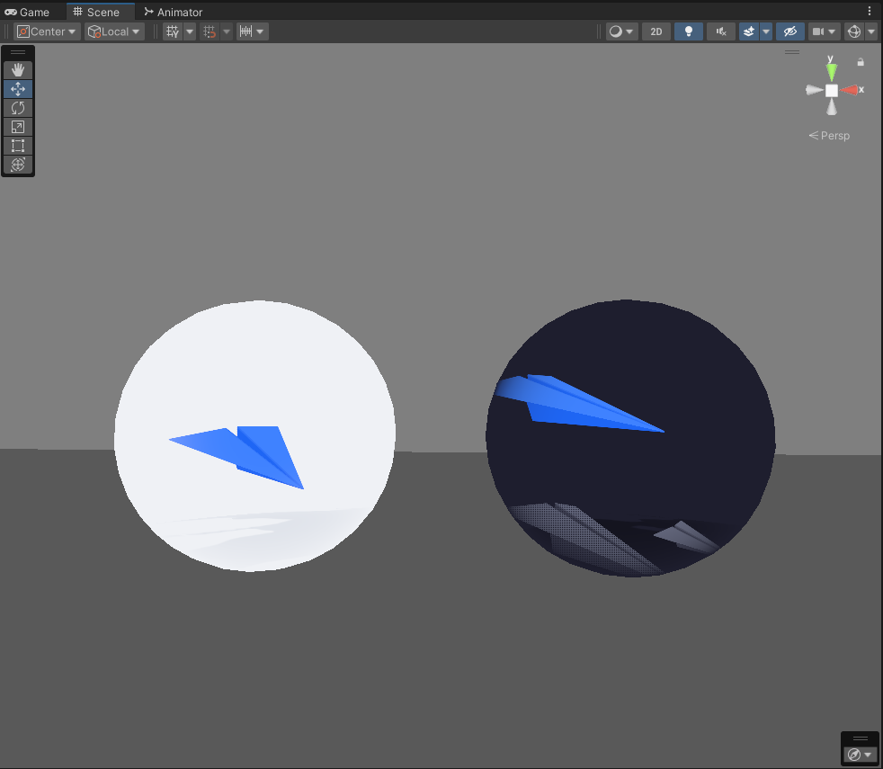
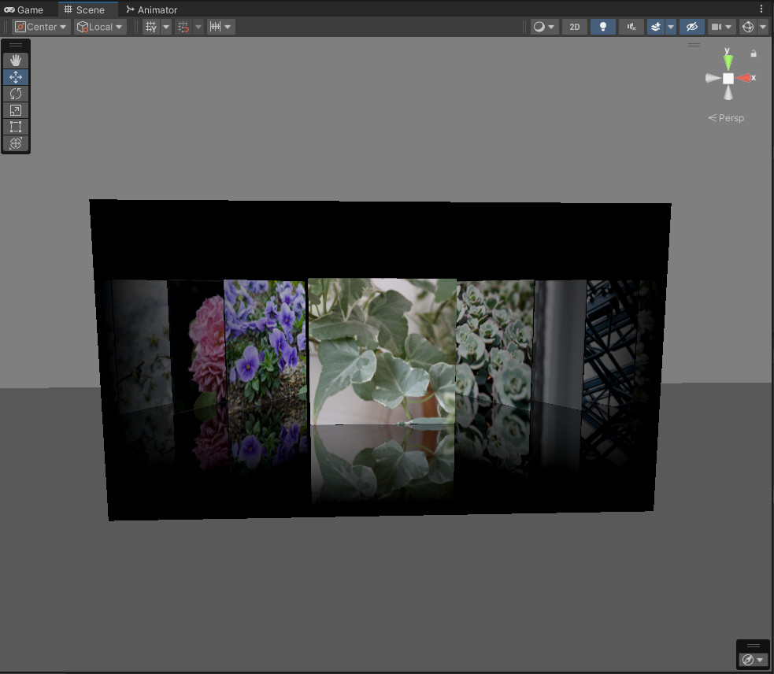

# shaderfes2027

CoverRail / Flying シェーダーと、その生成ツールのソースコード（CC BY 4.0）。Unity プロジェクトではなくアセット集です。

  
  

## 使い方
VRChat ワールド用の簡易 Unity プロジェクトです（Unity 2022.3.22f1）。VCC（VRChat Creator Companion）で「Add Existing Project」して開き、パッケージを解決してください。
`Assets/main.unity` を開くと全シェーダーを一通り確認できます（Play で ClientSim、または VRChat SDK からアップロード可能）。
シーンを作り直す場合は `Tools > nekochanfood > Build Main Scene`。

| パス | 内容 |
|---|---|
| `nekochanfood/Shaders/CoverRail` | CoverRail シェーダー・マテリアル・履歴用 CustomRenderTexture・カバーアトラス |
| `nekochanfood/Shaders/Flying` | FlyingPlane シェーダー・HLSL・VAT |
| `nekochanfood/Udon` | CoverRailHistory 用 CRT 更新 UdonSharp スクリプト |
| `nekochanfood/Tools/CoverRail` | アトラス生成 Python (`CoverRailAtlas.py` 等) とシェーダーテスト |
| `nekochanfood/Tools/Flying` | VAT ベイカー (メニュー: Tools > nekochanfood > Bake Flying Plane VAT) |

アトラス再生成: `python nekochanfood/Tools/CoverRail/CoverRailAtlas.py`（numpy, Pillow が必要）

## License

[CC BY 4.0](https://creativecommons.org/licenses/by/4.0/) © 2026 nekochanfood. Attribution required.
